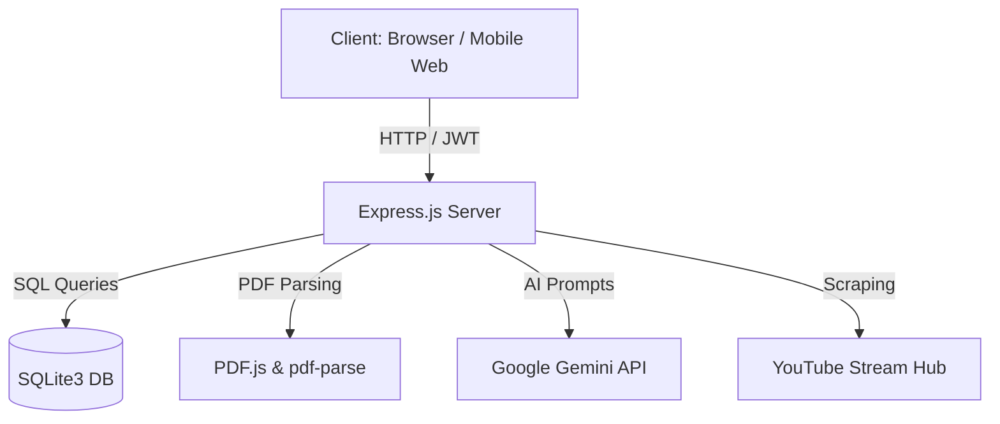

<div align="center">

# 📦 F I L E · B O X 📦
### *The Ultimate AI-Powered Minimalist Ebook & Media Hub*


[](https://nodejs.org/)
[](https://expressjs.com/)
[](https://www.sqlite.org/)
[](https://aistudio.google.com/)
[](LICENSE)

<br>


</div>

---

## ⚡ What is File-Box?

**File-Box** is a lightning-fast, mobile-first reading sanctuary. Designed with absolute focus in mind, it bridges the gap between local library management and cutting-edge generative AI, allowing you to converse with your documents seamlessly.

---

## ✨ Core Features & Highlights

| Feature | Description |
| :--- | :--- |
| 🧠 **AI Reading Copilot** | Powered by **Google Gemini API**. Highlight text or ask questions to get instant, concise summaries tailored to your active page. |
| 🔄 **Dual Adaptive Nav** | Features a gorgeous **Glassmorphism bar** on Desktop and an immersive **Radial Wheel UI** for thumb-friendly mobile navigation. |
| 📚 **Smart PDF Indexing** | Automatically scans local directories, extracts content into high-performance search memory, and indexes uploads instantly. |
| 🎵 **Integrated YouTube Hub** | Built-in media scraper and player to stream ambient study sounds or podcasts without leaving your reading flow. |
| 🔔 **Intelligent Nudges** | Tracks your reading streaks and greets you with dynamic AI reminders if your books stay untouched too long. |
| 🔒 **Secure Auth & Sync** | Robust multi-user architecture secured via `bcryptjs` encryption and session tracking using JSON Web Tokens (`JWT`). |

---

## 🚀 Tech Stack & Architecture



* **Backend Runtime**: Node.js & Express.js
* **Database Engine**: SQLite3 (`better-sqlite3` for synchronized synchronous performance)
* **AI Engine**: Google Gemini REST Endpoints (`gemini-1.5-flash`)
* **Frontend Interface**: Vanilla ES6+, HTML5 Canvas (`pdf.js`), Glassmorphic CSS variables
* **Utilities & Security**: `bcryptjs`, `jsonwebtoken`, `multer`

---

## 🛠️ Quick Run Guide

Get your local instance running in under 2 minutes.

### 1. Clone the Repository

```bash
git clone [https://github.com/sr464a6/File-Box.git](https://github.com/sr464a6/File-Box.git)
cd File-Box

```

### 2. Install Dependencies

```bash
npm install

```

### 3. Set Up Environment Variables

Create a `.env` file in your root directory:

```env
GEMINI_API_KEY="AIzaSyYourActualGeminiApiKeyHere"
PORT=3000

```

### 4. Prepare Folders & Start Server

```bash
mkdir -p pdf data/uploads
npm start

```

Open your browser and navigate to:

```text
http://localhost:3000

```

---

## 📂 Project Structure

```text
File-Box/
├── 📁 data/               # SQLite database, search index cache, & uploads
├── 📁 pdf/                # Default preloaded server-side ebook libraries
├── 📁 public/             # Frontend UI, Service Workers, & PDF rendering assets
├── 📄 server.js           # Express API router, database layer, & Gemini bridge
└── 📄 .env                # Private API credentials

```

---

---

Bagaimana? Ini jauh lebih hidup karena ada animasi gelombang (*wave header/footer*), grafik arsitektur `mermaid`, tabel fitur bergaris, badge statistik interaktif, serta efek *typing text* di bagian bawah!
